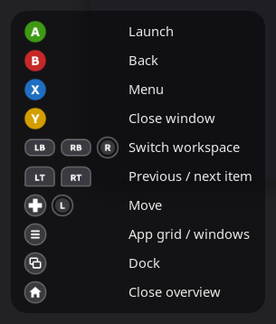
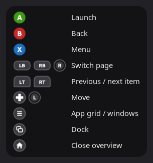
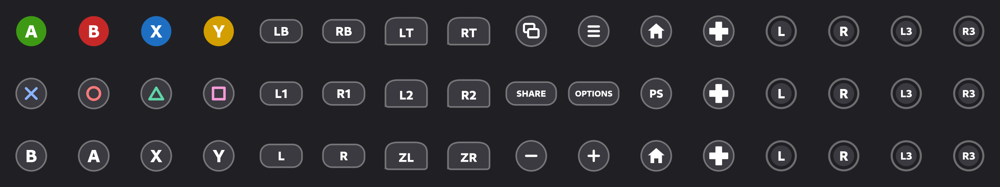

<p align="center"></p>

<h1 align="center">Gamepad Navigation</h1>

A GNOME Shell extension for using the overview with a game controller: open it with the Xbox/PS/Home button, move with the D-pad or sticks, and launch apps with A.

| Window overview | App grid |
|---|---|
|  |  |

<!-- TODO: add the demo video, same style as reticos-rgb, then remove this comment:
## Video

Navigating the overview with an Xbox 360 controller:

- https://youtube.com/shorts/...
-->

## What it does

- The **Xbox / PS / Home button** acts like the Super key: press it once for the overview, twice quickly for the app grid. Over fullscreen apps it does nothing, so games keep it (you can change that in the settings).
- All other buttons only work while the overview is open, so nothing reaches games or apps.
- A **button hint overlay** in a corner of the overview shows what each button does, drawn in the style of the connected controller: Xbox (shown above), PlayStation or Nintendo. All glyphs are shown [further down](#glyphs).
- Every button, the D-pad and both sticks can be remapped in the settings.

Default layout (Xbox names):

| Input | Action |
|---|---|
| A / B | Launch / back |
| X | Context menu |
| Y | Close the selected window (window overview) |
| LB / RB, right stick | Previous / next workspace or app page, like the scroll wheel |
| LT / RT | Previous / next item |
| D-pad, left stick | Move |
| Start | App grid ↔ windows |
| View (Back) | Jump into the dock, press again to jump back. Pinned apps only appear in the dock, not in the app grid. |
| L3 / R3 | Free to assign |

## How it works

The extension reads the controller's event device under `/dev/input` directly. logind gives the logged-in user access to it, so no root, udev rule or extra service is needed. It turns input into keypresses on a virtual keyboard, the same way GNOME's on-screen keyboard does. So GNOME itself does the navigating, and updates are unlikely to break it.

Only three things go beyond keypresses, because GNOME has no reliable key for them: opening the app grid directly (the "Toggle app grid" action), closing a window (window previews have no key for their close button) and jumping into the dock.

Steam keeps the controller open too, but doesn't grab it exclusively, so both work at the same time.

## Install

```sh
git clone https://github.com/inxomnyaa/gamepad-nav.git ~/.local/share/gnome-shell/extensions/gamepad-nav@inxomnyaa
```

Log out and back in, then:

```sh
gnome-extensions enable gamepad-nav@inxomnyaa
gnome-extensions prefs gamepad-nav@inxomnyaa
```

Needs GNOME 51.

## Glyphs

The button icons in `icons/` are generated. To change them, edit `tools/make-icons.py`, then run:

```sh
python3 tools/make-icons.py
gjs -m tools/preview-glyphs.js icons docs/glyphs.png
```



## Known GNOME problems

Some rough edges come from GNOME's own keyboard navigation, not from this extension. They are collected in [docs/gnome-issues.md](docs/gnome-issues.md).

## Credits

Idea, testing and design feedback by [inxomnyaa](https://github.com/inxomnyaa). Code, glyphs and docs written by [Claude](https://claude.ai) (Anthropic) in Claude Code.

## License

MIT: use, change and share it freely, including commercially, as long as the copyright notice stays in. See [LICENSE](LICENSE). The glyphs are original drawings: no console logos are used.
